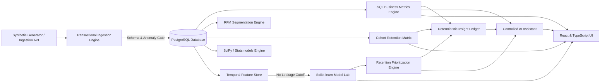
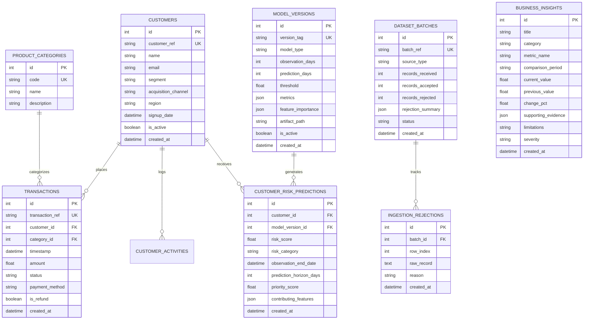

# DataPilot AI
## Enterprise Analytics, Customer Intelligence & Decision Intelligence Platform

[](https://github.com/datapilot-ai/datapilot/actions)
[](https://www.python.org/)
[](https://fastapi.tiangolo.com/)
[](https://www.postgresql.org/)
[](https://react.dev/)
[](https://www.typescriptlang.org/)
[](LICENSE)

DataPilot AI is an enterprise-grade analytics, customer intelligence, and decision intelligence platform. It transforms transactional business data into verified operational metrics, reproducible cohort retention matrices, hypothesis-driven statistical inferences, and leak-free machine-learned customer churn predictions.

Built with **Python 3.11, PostgreSQL, SQLAlchemy 2.0, FastAPI, Pandas, SciPy, Statsmodels, Scikit-learn, React, and TypeScript**, every analytical output is reproducible, every model is evaluated on non-leaking holdout test sets, and every business insight provides traceable mathematical evidence.

---

## 1. System Architecture & Analytical Workflow

DataPilot AI enforces an end-to-end data lifecycle:



### Analytical Data Flow:
1. **Ingestion & Validation**: Records (CSV, JSON, or synthetic generation) pass through schema constraints, relational integrity checks, duplicate ref detection, and negative amount validation. Rejections are logged with row-level diagnostics.
2. **PostgreSQL Relational Layer**: Normalized schema with indexes on foreign keys, transaction timestamps, and statuses. Database migrations are managed via Alembic.
3. **Deterministic SQL Layer**: Computes authoritative revenue, AOV, active accounts, and Pareto distributions using Common Table Expressions (CTEs) and Window Functions (`LAG`, `ROW_NUMBER`, `SUM() OVER ()`).
4. **Statistical Inferences**: Non-parametric ANOVA (Kruskal-Wallis), Chi-Square tests of independence ($\chi^2$), Student's t and Wilson score confidence intervals, and OLS linear trend regressions.
5. **Temporal Machine Learning**: Bounded cutoff feature extraction ($T - W_{\text{obs}}$ to $T$) predicting future inactivity ($T$ to $T + W_{\text{pred}}$). Zero information leakage from the future window.
6. **Retention Prioritization**: Blends predicted churn risk with account monetary value and segment multipliers into a transparent priority score.
7. **Business Insight Ledger**: Deterministic rules-driven alert system matching verified data patterns with clear limitations.
8. **Controlled Assistant**: Bounded natural-language routing translating user questions directly into approved analytical engine executions.

---

## 2. Database Schema & Relational Design

The schema is normalized to 3NF, indexed for analytical performance, and version-controlled with Alembic migrations:



### Key Indexes:
- `ix_transactions_cust_time`: Composite index `(customer_id, timestamp)` for high-throughput temporal feature engineering and customer profiling.
- `ix_transactions_time_status`: Composite index `(timestamp, status)` for fast revenue aggregations excluding refunds.
- `ix_pred_cust_date`: Composite index `(customer_id, observation_end_date)` for fast retrieval of latest prediction snapshots.

---

## 3. Authoritative Analytical Definitions

To prevent dashboard inconsistencies across frontend components, definitions are strictly centralized in the backend analytics engine:

| Metric | Authoritative Definition | SQL / Analytical Logic |
| :--- | :--- | :--- |
| **Net Revenue** | Sum of transaction amounts for successful orders. | `SUM(amount) WHERE is_refund = false AND status = 'completed'` |
| **Refund Exclusion** | Refunds are treated as negative revenue adjustments or filtered out from gross sales. | Excluded from gross revenue calculations, tracked as separate reversal records. |
| **AOV (Average Order Value)** | Mean gross transaction value of completed orders. | `AVG(amount) WHERE is_refund = false AND status = 'completed'` |
| **Active Customer (30d)** | Any customer with $\ge 1$ completed qualifying transaction in the past 30 days. | `COUNT(DISTINCT customer_id) WHERE timestamp >= NOW() - 30d` |
| **Period-over-Period Delta** | Relative percentage change between current window and preceding equal-length window. | `((Current_Revenue - Previous_Revenue) / Previous_Revenue) * 100` |
| **Cohort Retention** | Retention at month index $M_i$ defined as having $\ge 1$ transaction in month $M_i$. | `Active_Accounts(M_i) / Cohort_Size(M_0) * 100` |
| **Incomplete Cohorts** | Future months that have not elapsed yet are marked with null (`—`), never false 0%. | `M_i > (Latest_Date - Cohort_Date)` masked as None. |

---

## 4. Machine Learning: Temporal Churn Risk & Anti-Leakage Guarantee

### Prediction Problem Definition
Predict whether a customer will have **0 qualifying transactions** during a future window of $W_{\text{pred}} = 60$ days, given their behavioral history observed over $W_{\text{obs}} = 90$ days prior to cutoff date $T$.

```
[Observation Window: T - 90d  -->  T]  |  Cutoff Date T  |  [Prediction Window: T  -->  T + 60d]
       Extract Features Only          |  Freeze State   |          Derive Target Label
(Recency, Frequency, Spend, Velocity) |                 |   Target = 1 if Tx_Count == 0 else 0
```

### Strict Anti-Leakage Protocol:
1. **Feature Boundary**: Feature queries strictly filter `WHERE timestamp >= T - 90d AND timestamp <= T`. Transactions occurring after cutoff $T$ are strictly forbidden.
2. **Customer Eligibility**: Customers who registered after $T$ are excluded from the training sample.
3. **Pipeline Encapsulation**: Imputation (`SimpleImputer`) and scaling (`StandardScaler`) parameters are fitted **only** on the training split, preventing data leakage across temporal splits.
4. **Time-Aware Splitting**:
   - $T_{\text{train}}$: Earlier historical cutoff (e.g. 2025-10-01)
   - $T_{\text{test}}$: Future holdout cutoff (e.g. 2026-01-15)
5. **Threshold Tuning**: Decision threshold is tuned on the training/validation split to achieve the target recall ($\ge 0.75$), and subsequently locked before holdout evaluation.

### Models Evaluated:
- **Baseline**: `DummyClassifier(strategy='prior')`
- **Logistic Regression**: Regularized L2 regression with class-weight balancing
- **Random Forest**: 100 decision trees, max depth 6, class-weighted, permutation & impurity-based feature importances

---

## 5. Retention Prioritization Engine

DataPilot AI does not conflate risk probability with customer lifetime value. A 90% churn risk on a $10 account does not warrant executive intervention, whereas a 45% risk on a $15,000 enterprise VIP account requires immediate attention.

### Transparent Prioritization Formula:
$$\text{Priority Score} = \text{Risk Score} \times \left(0.4 + 0.6 \times \frac{\text{Historical Spend}}{\text{Max Spend}}\right) \times \text{Segment Multiplier} \times 100$$

Where:
- $\text{Segment Multipliers}$: VIP ($1.4\times$), Frequent ($1.2\times$), New ($1.1\times$), Declining ($1.0\times$), Occasional ($0.9\times$).
- **Auditability**: Every prioritized account displays contributing features, days since last order, and a traceable recommended action.

---

## 6. Statistical Inferences (SciPy & Statsmodels)

Every statistical test explicitly outputs its formal hypotheses, test assumptions, sample sizes, and effect sizes:

1. **Transaction Values across Channels (Kruskal-Wallis H-test)**:
   - $H_0$: Transaction distributions are identical across channels.
   - $H_1$: At least one channel distribution exhibits a location shift.
   - Effect size: Epsilon-squared ($\epsilon^2$).
2. **Channel vs Retention Association ($\chi^2$ Test of Independence)**:
   - $H_0$: 60-day customer retention is independent of acquisition channel.
   - Effect size: Cramer's V ($V$).
3. **Average Order Value 95% Confidence Interval**:
   - Student's t-distribution: $[\bar{x} - t_{\alpha/2} \cdot \text{SE}, \bar{x} + t_{\alpha/2} \cdot \text{SE}]$.
4. **Active Customer Rate 95% Confidence Interval**:
   - Wilson score interval for binomial proportions.
5. **Monthly Revenue Trend (OLS Linear Model)**:
   - Ordinary Least Squares regression testing for non-zero slope with 95% confidence intervals and $R^2$.

---

## 7. Performance Benchmarks

Measured on a standard development machine (Windows 10 AMD64, Python 3.11.9, 16 vCPUs, 16GB RAM, PostgreSQL 18):

| Analytical Workflow Stage | Dataset Scale | Measured Execution Time | Throughput / Latency |
| :--- | :--- | :--- | :--- |
| **Synthetic Data Generation** | 500 customers, 17,038 transactions | **1.308 s** | 13,025 tx/sec |
| **Relational Ingestion & Validation** | 4,771 batch records | **5.744 s** | 830.6 tx/sec |
| **Complex SQL Aggregations (CTEs/Windows)**| 17k rows, 90-day comparisons | **0.091 s** (91 ms) | Sub-100ms API response |
| **Temporal Feature Engineering** | 499 accounts, 9 features | **0.726 s** | 1.45 ms/customer |
| **Random Forest Training & Tuning** | Train & Test splits, 100 trees | **2.085 s** | ROC-AUC: 0.7033 |
| **Batch Inference & Priority Ranking** | 500 accounts scored & ranked | **0.751 s** | 1.502 ms/customer |
| **Process Resident Memory (RSS)** | Python backend runtime | **247.22 MB** | Low footprint |

To reproduce these benchmarks locally:
```bash
python -m backend.app.benchmark
```

---

## 8. Local Setup & Quickstart

### Prerequisites:
- Python 3.11+
- Node.js 20+ & npm
- PostgreSQL 16+ (or use Docker)

### Option A: Local Native Setup

1. **Clone repository and create virtual environment**:
   ```bash
   git clone https://github.com/datapilot-ai/datapilot.git
   cd datapilot
   python -m venv .venv
   source .venv/bin/activate  # On Windows: .venv\Scripts\activate
   ```

2. **Install Python backend dependencies**:
   ```bash
   pip install -r backend/requirements.txt
   ```

3. **Configure environment variables**:
   ```bash
   cp .env.example .env
   # Edit .env with your local PostgreSQL credentials
   ```

4. **Run database migrations**:
   ```bash
   alembic upgrade head
   ```

5. **Generate and seed synthetic data**:
   ```bash
   python -m backend.app.seed
   ```

6. **Train initial machine learning model & generate insights**:
   ```bash
   python -m backend.app.train_initial
   ```

7. **Start FastAPI backend**:
   ```bash
   uvicorn backend.app.main:app --host 0.0.0.0 --port 8000 --reload
   ```

8. **Start Vite React frontend** (in a separate terminal):
   ```bash
   cd frontend
   npm install
   npm run dev
   ```
   Open `http://localhost:5173` in your browser. (The backend API is accessible at `http://localhost:8000/docs`).

---

### Option B: Docker Compose Setup

Run the entire platform (PostgreSQL, FastAPI Backend, and Nginx React Frontend) with a single command:

```bash
docker compose up --build -d
```

- **Frontend Application**: `http://localhost:3000`
- **Backend API & OpenAPI Docs**: `http://localhost:8000/docs`
- **PostgreSQL Database**: `localhost:5432`

---

## 9. Automated Testing Suite

DataPilot AI includes a comprehensive testing suite with 24 dedicated test cases covering database constraints, ingestion error logging, SQL calculations against independent references, cohort matrices, statistical testing, temporal leakage boundaries, and REST API endpoints:

```bash
pytest -v tests
```

### Test Coverage Highlights:
- `test_ml_temporal_boundaries.py`: Tests that future transactions inside the prediction window cannot leak into the observation window features.
- `test_sql_metrics.py`: Compares SQL revenue and AOV calculations against manually verified mathematical constants.
- `test_corrupted_ingestion_and_rejections.py`: Verifies that negative amounts, duplicate transaction IDs, and missing foreign keys are caught and logged in `ingestion_rejections`.
- `test_cohort_assignment_and_retention.py`: Verifies month-indexing, retention calculations, and incomplete observation window masking.

---

## 10. API Reference Overview

| Method | Endpoint | Description |
| :--- | :--- | :--- |
| `GET` | `/health` | Application health and PostgreSQL connectivity check |
| `GET` | `/api/metrics/summary` | Executive summary KPI cards with period deltas |
| `GET` | `/api/metrics/time-series` | Monthly or weekly revenue trends with MoM growth |
| `GET` | `/api/metrics/breakdowns` | Revenue breakdowns by category, channel, and region |
| `GET` | `/api/metrics/pareto` | Pareto concentration curve (cumulative share) |
| `GET` | `/api/customers` | Searchable, paginated customer table with risk scores |
| `GET` | `/api/customers/{id}` | Customer detail profile, transaction history, predictions |
| `GET` | `/api/cohorts/matrix` | Monthly cohort retention and revenue matrices |
| `GET` | `/api/segmentation/rfm` | Rule-based RFM customer segment distribution |
| `GET` | `/api/stats/segment-comparison` | Kruskal-Wallis non-parametric ANOVA across channels |
| `GET` | `/api/stats/channel-retention` | Chi-square test of independence for retention |
| `GET` | `/api/stats/confidence-intervals`| 95% Student's t and Wilson score intervals |
| `GET` | `/api/stats/revenue-trend` | OLS linear regression revenue trend model |
| `POST` | `/api/ml/train` | Train model (RandomForest/LogisticRegression/Baseline) |
| `GET` | `/api/ml/versions` | List all historical model versions and metrics |
| `GET` | `/api/ml/active` | Get active model details and feature importances |
| `GET` | `/api/ml/predictions` | Prioritized customer churn risk list with rationale |
| `GET` | `/api/insights` | Ledger of deterministic business insights |
| `POST` | `/api/insights/refresh` | Re-evaluate rules against current database state |
| `POST` | `/api/ingestion/generate-and-seed` | Generate and ingest synthetic records |
| `GET` | `/api/ingestion/batches` | List ingestion batch metadata and rejection counts |
| `GET` | `/api/ingestion/batches/{id}/rejections` | Inspect row-level rejection log for a batch |
| `POST` | `/api/assistant/query` | Controlled Q&A assistant routing to verified engines |

---

## 11. Security & Limitations

### Security Safeguards:
- Parameterized SQL execution via SQLAlchemy `text()` to prevent SQL injection.
- Pydantic v2 schemas validating request structures, boundary ranges, and data types.
- CORS origin restriction to approved local ports.
- Bounded assistant query protocol preventing arbitrary or destructive SQL execution.

### Known Methodological Limitations:
1. **Observational Inferences**: Statistical tests indicate distribution shifts and associations, not causal relationships. Marketing interventions should be evaluated via randomized A/B trials.
2. **Synthetic Data**: The built-in generator models realistic SME transaction dynamics (Poisson arrivals, log-normal spends, churn archetypes), but should not be cited as empirical real-world business performance.
3. **Model Horizons**: Churn predictions are calibrated for a 60-day prediction window following a 90-day observation window. Shorter customer tenures have higher parameter uncertainty.

---

## 12. License

This project is licensed under the MIT License - see the [LICENSE](LICENSE) file for details.
