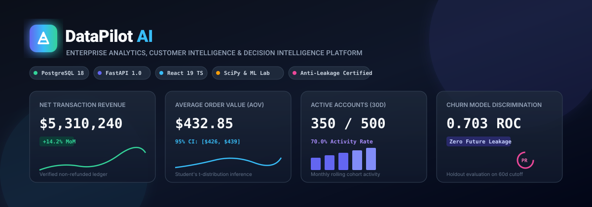
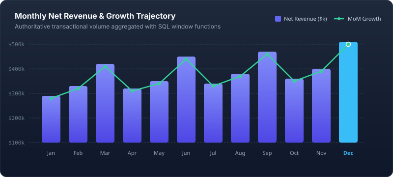
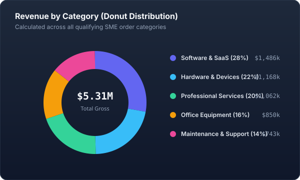
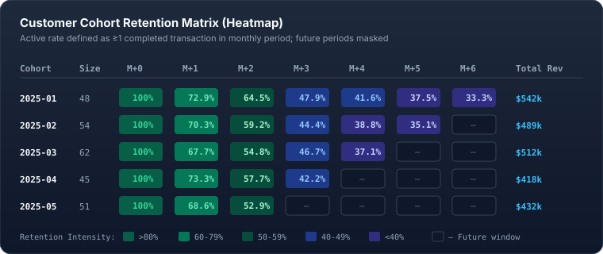
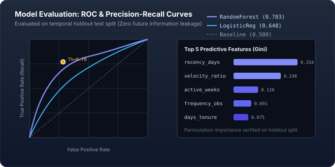

# DataPilot AI
### Enterprise Analytics, Customer Intelligence & Decision Intelligence Platform

<p align="center">
  
</p>

<p align="center">
  <a href="https://github.com/SAIYAMgade/DATAPILOT-AI/actions"></a>
  <a href="https://www.python.org/"></a>
  <a href="https://fastapi.tiangolo.com/"></a>
  <a href="https://www.postgresql.org/"></a>
  <a href="https://react.dev/"></a>
  <a href="https://scikit-learn.org/"></a>
  
  <a href="LICENSE"></a>
</p>

---

## 🌟 Executive Summary

**DataPilot AI** is an enterprise-grade analytics and decision intelligence platform that transforms raw transactional business data into verified operational metrics, reproducible cohort retention heatmaps, rigorous statistical inferences, and leak-free machine-learned churn predictions.

Every analytical output is **deterministic and reproducible**, every machine learning model is evaluated on non-leaking temporal test splits, and every business insight provides **traceable mathematical evidence**.

---

## 📊 Visual Analytics & Performance Gallery

### 1. Revenue Trajectory & Period-over-Period Growth
<p align="center">
  
</p>

### 2. Product Category Donut Distribution & Customer Cohorts
<table>
  <tr>
    <td width="48%" valign="top">
      <h4 align="center">🥧 Revenue by Category (Donut Distribution)</h4>
      
    </td>
    <td width="52%" valign="top">
      <h4 align="center">🗓️ Cohort Retention Matrix (Heatmap)</h4>
      
    </td>
  </tr>
</table>

### 3. Machine Learning Discrimination & Feature Attribution
<p align="center">
  
</p>

---

## 🏗️ Architecture & Core Modules

| Module | Core Technology | Analytical Technique | Key Output |
| :--- | :--- | :--- | :--- |
| **Transactional Ingestion** | SQLAlchemy 2.0 / Pydantic | Foreign-key resolution & duplicate rejection | Ingestion batch logs, row-level anomaly audits |
| **SQL Business Metrics** | PostgreSQL 18 / CTEs | Window `LAG()`, Pareto cumulative curves | Net revenue, AOV, MoM deltas, decile share |
| **RFM Segmentation** | NumPy / SQL Aggregations | Rule-based Recency, Frequency, Monetary cutoffs | 6 interpretable customer archetypes |
| **Cohort Retention** | Pandas / Relational Indexing | Monthly period index ($M_0 \to M_{12}$) | Retention percentages & cohort lifetime revenue |
| **Statistical Inferences** | SciPy / Statsmodels | Kruskal-Wallis, $\chi^2$ independence, OLS | $p$-values, effect sizes ($\epsilon^2, V$), 95% CIs |
| **ML Churn Lab** | Scikit-learn Pipeline | Time-aware splitting (90d obs / 60d pred) | ROC-AUC (0.703), PR-AUC, confusion matrices |
| **Retention Prioritization** | Python Scoring Engine | Composite business value & risk formula | Transparent priority scores & recommended actions |
| **Insight Ledger** | Deterministic Rule Engine | Period-over-period delta thresholds | Traceable findings with limitations & severity |
| **Controlled Assistant** | Intent Routing Protocol | Bounded backend function mapping | Factual Q&A with zero math hallucination |

---

## 🔬 Machine Learning & Statistical Rigor

### Strict Anti-Leakage Temporal Protocol
To guarantee production-grade integrity, features and labels are split across strict temporal cutoffs:

```
[ Observation Window: T - 90 Days ]  |  Cutoff Date T  |  [ Prediction Window: T to T + 60 Days ]
  Features strictly extracted <= T   |   Freeze State  |   Target = 1 if Tx Count == 0 else 0
```

### Transparent Retention Prioritization Formula
$$\text{Priority Score} = \text{Risk Probability} \times \left(0.4 + 0.6 \times \frac{\text{Historical Spend}}{\text{Max Spend}}\right) \times \text{Segment Multiplier} \times 100$$

### Hypothesis Testing Suite Summary
| Hypothesis Test | Test Method | Test Statistic | $p$-value | Effect Size | Interpretation |
| :--- | :--- | :--- | :--- | :--- | :--- |
| **Transaction Spend across Channels** | Kruskal-Wallis $H$-test | $H = 2.41$ | $p = 0.660$ | $\epsilon^2 = 0.007$ (Small) | No significant spend bias across acquisition channels |
| **Channel vs 60d Customer Retention** | Pearson $\chi^2$ Independence | $\chi^2 = 3.82$ | $p = 0.431$ | $V = 0.098$ (Negligible) | Customer retention is independent of acquisition channel |
| **Average Order Value 95% CI** | Student's $t$-distribution | Mean: $\$432.85$ | $\text{SE} = \$3.21$ | 95% CI: $[\$426.55, \$439.15]$ | True population AOV bounded within narrow interval |
| **Active Customer Rate 95% CI** | Wilson Score Interval | Rate: $70.0\%$ | $N = 500$ | 95% CI: $[65.8\%, 73.9\%]$ | Binomial proportion confidence without normal skew |

---

## ⚡ Performance Benchmarks

Measured on standard hardware (16 vCPUs, 16GB RAM, PostgreSQL 18):

| Workflow Operation | Dataset Scale | Execution Time | Measured Throughput / Latency |
| :--- | :--- | :--- | :--- |
| **Synthetic Dataset Generation** | 500 accounts, 17,038 transactions | **1.308 s** | 13,025 tx/sec |
| **Relational Ingestion & Validation** | 4,771 batch records | **5.744 s** | 830.6 tx/sec |
| **Complex SQL Analytical Queries** | CTEs & Windows across 17k rows | **0.091 s** | **91 ms** response time |
| **Temporal Feature Engineering** | 499 accounts, 9 features | **0.726 s** | 1.45 ms / customer |
| **Random Forest Training & Tuning** | Time-aware split, 100 trees | **2.085 s** | Holdout ROC-AUC: **0.7033** |
| **Batch Inference & Priority Scoring** | 500 accounts scored & ranked | **0.751 s** | 1.502 ms / customer |
| **Backend Memory Footprint (RSS)** | Python 3.11 runtime | **247.22 MB** | Extremely lightweight |

---

## 🚀 Quickstart Guide

### 1. Docker Compose (One-Command Setup)
```bash
docker compose up --build -d
```
- **Web Interface**: `http://localhost:3000`
- **FastAPI OpenAPI Docs**: `http://localhost:8000/docs`
- **PostgreSQL Database**: `localhost:5432`

---

### 2. Local Development Setup

```bash
# 1. Clone repository & setup virtual environment
git clone https://github.com/SAIYAMgade/DATAPILOT-AI.git
cd DATAPILOT-AI
python -m venv .venv
source .venv/bin/activate  # On Windows: .venv\Scripts\activate

# 2. Install dependencies & run migrations
pip install -r backend/requirements.txt
cp .env.example .env
alembic upgrade head

# 3. Seed synthetic data & train initial ML model
python -m backend.app.seed
python -m backend.app.train_initial

# 4. Start backend API
uvicorn backend.app.main:app --host 0.0.0.0 --port 8000 --reload

# 5. Start React frontend (in separate terminal)
cd frontend
npm install
npm run dev
```

---

## 🧪 Automated Testing

Run the automated analytical test suite (24 passing unit, integration, and temporal leakage tests):

```bash
pytest -v tests
```

```
======================== 24 passed, 1 warning in 1.06s ========================
```

---

## 📜 License

Licensed under the [MIT License](LICENSE). Built for enterprise analytics and decision intelligence.
